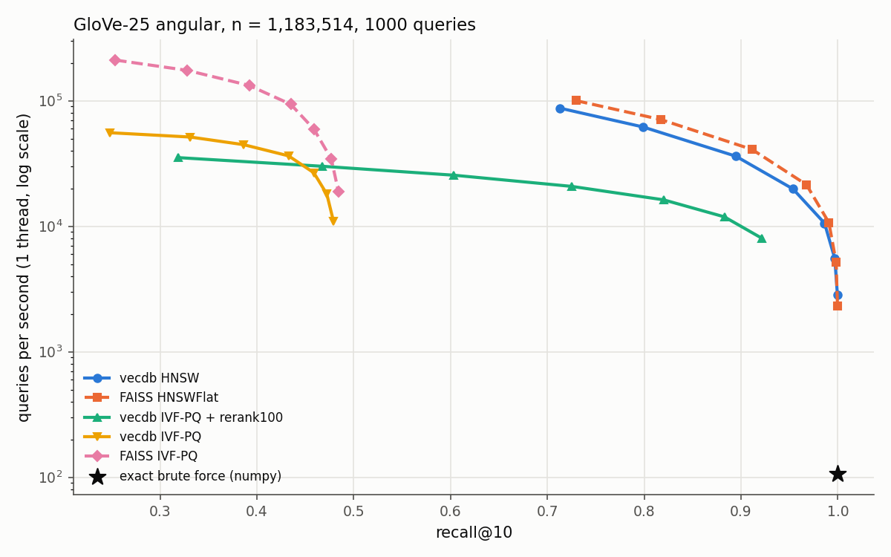
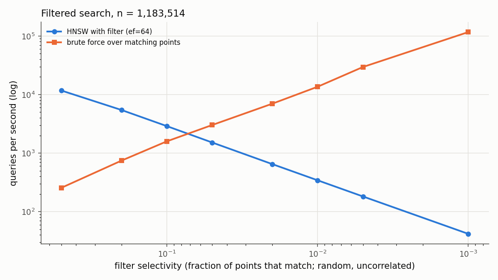
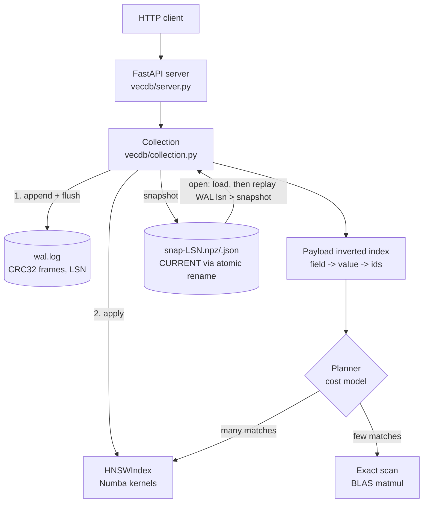

# vecdb: a vector database built from scratch

vecdb is a small vector database written from first principles in Python + Numba:

* **HNSW graph index** (Malkov & Yashunin 2016) with the neighbour-selection
  heuristic, tombstone deletes and filtered search.
* **IVF-PQ compressed index** (Jegou et al. 2011): k-means cells, 8-bit product
  quantisation, asymmetric distance with precomputed tables, optional exact re-ranking.
* **Durable collections**: CRC-framed write-ahead log with torn-write recovery,
  LSN-tagged atomic snapshots, string ids and JSON payloads.
* **Filtered-search planner** that chooses between graph traversal and brute force
  using a cost model fitted to measured data.
* **HTTP API** (FastAPI), CLI, Docker image.

It is benchmarked on the public GloVe-25 ANN dataset (1,183,514 vectors) against exact
search and against FAISS, the reference C++ library, at identical parameters.

## Key results

All numbers below are copied from `reports/` (produced by
`benchmarks/run_benchmarks.py`). Single thread for every method, 1,000 queries,
k = 10, HNSW M = 16 and ef_construction = 200, best of 3 runs. Machine: Apple M5
laptop (macOS arm64), Python 3.11.



### Full dataset, n = 1,183,514

| Method | Param | Recall@10 | QPS (1 thread) |
|---|---|---|---|
| exact (numpy) |  | 1.0000 | 107 |
| vecdb HNSW | ef=32 | 0.8946 | 36,192 |
| vecdb HNSW | ef=64 | 0.9536 | 19,856 |
| vecdb HNSW | ef=128 | 0.9862 | 10,587 |
| vecdb HNSW | ef=256 | 0.9968 | 5,531 |
| FAISS HNSWFlat | ef=32 | 0.9114 | 40,957 |
| FAISS HNSWFlat | ef=64 | 0.9675 | 21,473 |
| FAISS HNSWFlat | ef=128 | 0.9907 | 10,701 |
| FAISS HNSWFlat | ef=256 | 0.9981 | 5,197 |
| vecdb IVF-PQ | nprobe=64 | 0.4791 | 10,982 |
| vecdb IVF-PQ + rerank100 | nprobe=32 | 0.8828 | 11,892 |
| vecdb IVF-PQ + rerank100 | nprobe=64 | 0.9212 | 8,054 |
| FAISS IVF-PQ | nprobe=64 | 0.4842 | 18,929 |

| Build / memory | Value |
|---|---|
| vecdb HNSW build time | 177.1 s |
| FAISS HNSW build time | 186.1 s |
| vecdb HNSW memory (vectors + graph) | 290.6 MB |
| vecdb IVF-PQ memory (5-byte codes + ids + tables) | 36.8 MB |

What the numbers say:

* **HNSW vs exact search:** at recall 0.9862, vecdb HNSW answers 10,587 queries/s vs
  107 for brute force, a 99x speed-up.
* **vecdb vs FAISS HNSW:** at the same `ef`, vecdb reaches 0.87x to 1.22x of FAISS's QPS
  on 1.18M vectors (0.73x to 1.27x at 100k). FAISS gets slightly higher recall at each
  `ef` (0.9675 vs 0.9536 at ef=64), so at equal recall FAISS is somewhat faster.
  Build time is comparable (177.1 s vs 186.1 s).
* **IVF-PQ:** recall without re-ranking plateaus near 0.48 for both vecdb and FAISS,
  the accuracy ceiling of 5-byte codes on this data. Matching FAISS's recall
  (0.4791 vs 0.4842 at nprobe=64) is the correctness check; vecdb's scan is 1.7x
  slower (10,982 vs 18,929 QPS). Re-ranking the top 100 candidates with exact vectors
  lifts recall to 0.9212.

The same sweep on a 100,000-vector sample is in
[`reports/glove25_n100000/sweeps.json`](reports/glove25_n100000/sweeps.json)
(chart: `docs/recall_qps_glove25_n100000.png`).

### Filtered search and the planner

Random payload filters, uncorrelated with vector position, ef = 64:



| Selectivity | Matching (n=1.18M) | HNSW-filter recall | HNSW-filter QPS | Brute force over matches QPS |
|---|---|---|---|---|
| 0.5 | 591,519 | 0.9772 | 11,694 | 256 |
| 0.1 | 118,297 | 0.9958 | 2,891 | 1,588 |
| 0.05 | 59,044 | 0.9979 | 1,517 | 3,019 |
| 0.01 | 11,835 | 0.9997 | 344 | 13,582 |
| 0.001 | 1,191 | 1.0000 | 42 | 116,641 |

Filtered HNSW slows down as filters get more selective, because the beam must step
over more non-matching nodes. Brute force gets faster, because it only touches matching
points. The crossover moves with collection size: between 10% and 20% selectivity at
n = 100k, and between 5% and 10% at n = 1.18M. So a fixed threshold is wrong at one
scale or the other. The planner estimates both costs instead (see
`choose_filtered_plan` in `vecdb/collection.py`). Graded against the measured QPS of
both plans on all 16 cases (`benchmarks/eval_planner.py` -> `reports/planner.json`):

| Policy | Optimal choices (of 16) | Worst QPS vs best plan | Mean QPS vs best plan |
|---|---|---|---|
| cost model (default) | 15 | 0.726 | 0.983 |
| fixed selectivity < 0.1 | 15 | 0.550 | 0.972 |
| fixed count <= 10,000 | 13 | 0.025 | 0.851 |
| always exact | 11 | 0.022 | 0.785 |
| always HNSW | 5 | 0.0001 | 0.384 |

Caveat: the cost model's three constants were fitted on these same 16 rows, so this
is an in-sample score. A simple selectivity rule is almost as good; the main lesson is
that a fixed *count* threshold (or no planner) can be 40x to roughly 9,700x slower than
the right plan.

### Durability

From `reports/glove25_n1183514/durability.json` (20,000 25-d points):

| Measurement | Value |
|---|---|
| WAL append, no fsync, 1,000 records per write | 961,739 points/s |
| WAL append, F_FULLFSYNC per 1,000-record batch | 220,669 points/s |
| WAL append, F_FULLFSYNC per record | 257 points/s |
| Recovery by WAL replay (rebuilds the graph) | 1.573 s |
| Recovery from snapshot | 0.015 s |

Batching records under one sync (group commit) is ~860x faster than syncing each
record, and snapshots make restart ~100x faster than replaying the log.

## Architecture



## How it works

1. **Insert.** Vectors are normalised (cosine) and validated, written to the WAL with
   increasing LSNs, then inserted into HNSW: each node draws a random level, greedy
   descent finds an entry point, a beam search of width `ef_construction` finds
   candidates, and the selection heuristic picks up to M diverse neighbours with
   back-links re-pruned when lists overflow.
2. **Query.** Greedy descent through the sparse upper layers, then a best-first beam
   search of width `ef` on layer 0. Filters become a bitmask built from the payload
   inverted index. The planner decides whether to traverse the graph with the mask or to
   scan only the matching vectors.
3. **Delete / update.** Tombstones: the node keeps routing searches but is never
   returned. Updates are delete + insert.
4. **Recovery.** Load the snapshot named in `CURRENT`, replay WAL records with
   LSN greater than the snapshot's, truncate any torn tail found by length/CRC checks.

`WALKTHROUGH.md` explains each file, the design trade-offs and the evaluation in detail.

## Tech stack

Python 3.10-3.12, NumPy, Numba (LLVM JIT for the index kernels), FastAPI + Pydantic +
Uvicorn, pytest, Docker, GitHub Actions. Benchmarks: h5py, matplotlib, faiss-cpu
(reference only).

## Setup

```bash
python -m venv .venv && source .venv/bin/activate
pip install -r requirements-dev.txt
```

Run the API:

```bash
python -m vecdb serve --data ./vecdb-data --port 8000
```

```bash
curl -X POST localhost:8000/collections -H 'content-type: application/json' \
  -d '{"name": "docs", "dim": 3, "metric": "cosine"}'
curl -X PUT localhost:8000/collections/docs/points -H 'content-type: application/json' \
  -d '{"points": [{"id": "a", "vector": [1, 0, 0], "payload": {"lang": "en"}},
                  {"id": "b", "vector": [0, 1, 0], "payload": {"lang": "hi"}}]}'
curl -X POST localhost:8000/collections/docs/search -H 'content-type: application/json' \
  -d '{"vector": [0.9, 0.1, 0], "k": 1, "filter": {"lang": {"$in": ["en", "hi"]}}}'
```

Endpoints: `POST /collections`, `GET /collections`, `GET /collections/{name}`,
`PUT /collections/{name}/points`, `GET /collections/{name}/points/{id}`,
`POST /collections/{name}/points/delete`, `POST /collections/{name}/search`,
`POST /collections/{name}/snapshot`, `GET /health`. Interactive docs at `/docs`.

Docker:

```bash
docker build -t vecdb . && docker run -p 8000:8000 -v vecdb-data:/data vecdb
```

Library use:

```python
from vecdb import Collection
col = Collection("./mycol", dim=384)
col.upsert(["doc1"], [embedding], [{"source": "wiki"}])
col.search(query_embedding, k=5, filter={"source": "wiki"})
```

## Tests

```bash
python -m pytest -q
```

42 tests cover graph invariants (degree bounds, no self-loops, layer accounting,
reachability), recall floors, filters (including fewer matches than k), tombstones,
save/load equivalence, IVF-PQ distance correctness, WAL torn-tail and bit-flip
handling, crash recovery, snapshot + replay idempotence, the planner, and the HTTP API.

## Reproducing the benchmarks

```bash
pip install -r requirements-bench.txt
python benchmarks/run_benchmarks.py --n 100000      # ~2 min on an M-series laptop
python benchmarks/run_benchmarks.py --n 2000000     # full 1.18M set; each HNSW build ~3 min
python benchmarks/eval_planner.py
python benchmarks/plot.py reports/glove25_n1183514
```

The dataset (`glove-25-angular.hdf5`, 121 MB) is downloaded at runtime from
[ann-benchmarks](https://github.com/erikbern/ann-benchmarks) and verified against a
pinned SHA-256; it is not stored in the repo. GloVe vectors are by Pennington, Socher
and Manning (Stanford NLP), released under the
[Public Domain Dedication and License v1.0](https://opendatacommons.org/licenses/pddl/1-0/).
FAISS's Mac wheels may need OpenMP; if `import faiss` fails, run `brew install libomp`.

## Project structure

```
vecdb/
  hnsw.py          HNSW index (Numba kernels + Python wrapper, save/load)
  ivfpq.py         k-means, product quantisation, IVF-PQ search
  flat.py          exact top-k search
  wal.py           write-ahead log, framing, torn-write recovery
  collection.py    ids, payloads, filters, planner, snapshots, recovery
  server.py        FastAPI app
  cli.py           `python -m vecdb serve | info`
  datasets.py      GloVe-25 download + checksum + loading
benchmarks/
  run_benchmarks.py  recall/QPS sweeps, filtered, deletes, durability
  eval_planner.py    grades planner policies against measured QPS
  plot.py            charts into docs/
reports/           JSON results (source of every number in this README)
docs/              charts
tests/             pytest suite
```

## Limitations

* One dataset, 25 dimensions, cosine. Higher-dimensional embeddings (384-1536 d) shift
  costs toward distance computation and would change the IVF-PQ and planner numbers.
* Filters in the benchmark are random. Real filters often correlate with vector
  position (e.g. language), which can help or badly hurt filtered graph search
  (see ACORN, SIGMOD 2024).
* At n = 1.18M the IVF-PQ coarse quantiser (4,096 cells) is trained on a 50,000-point
  sample, about 12 points per cell, below FAISS's recommended 39. vecdb and FAISS use the
  same sample size so the comparison is fair, but both are under-trained.
* At 100k, the precomputed IVF-PQ tables (5.2 MB for 1,024 cells) are larger than the
  codes themselves; the trade-off only pays off at larger n.
* Deleted points are never reclaimed (no compaction); the graph is not repaired after
  deletes. Recall stayed at or above the no-delete value with up to 50% tombstones
  (`reports/*/deletes.json`), but memory grows.
* Single process, one lock per collection: searches on the same collection are
  serialised. No replication or sharding.
* Recovery by replay rebuilds the graph, so restart time without a recent snapshot grows
  with the WAL length.
* Wall-clock numbers depend on the machine; distance-computation counts in
  `sweeps.json` are hardware-independent.

## License

MIT, see [LICENSE](LICENSE).
